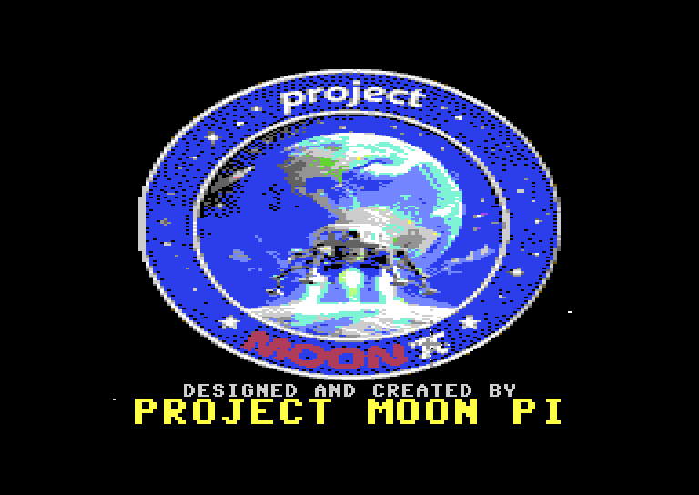

<p align="center"></p>
<p align="center"><b>Designed and Created by Project Moon Pi</b></p>

# Project Moon Pi intro for the Commodore 64

The animated Project Moon Pi logo intro from ProjectMoonPi.com, rebuilt for a real **NTSC Commodore 64**.
It is built to show what the machine can do.

<p align="center"></p>

The intro runs for about 8½ seconds:

1. **Starfield.** Pixel stars stream out from the middle, speeding up.
2. **Coin fly-in.** The badge flies in as a speck, flipping like a coin. It uses up to six multicolour
   sprites, pre-rendered at 13 sizes and 5 flip angles and double-buffered.
3. **Landing.** A white flash and a sideways jolt, then the screen switches video banks to the landed badge.
   The badge is an **FLI picture**, 172 lines tall, with new colours on every line instead of every 8. Six
   sparks fly off the rim.
4. **Light show.** A flare runs round the ring and bursts at the tip. The ring stars twinkle and the engine
   flames flicker.
5. **Credits.** **DESIGNED AND CREATED BY / PROJECT MOON PI** fades in, drawn in the C64's own character set.
6. **Switch-off.** An old-TV switch-off closes the picture to a line, then the machine resets to BASIC.

The SID plays a filtered string-and-brass chord gliding from C7 down to C3 as the badge flies in. Then comes one
bell-like strike and a drum as the starburst fires.

Any key or the joystick fire button skips the intro.

## Running it

```
LOAD"MOON PI INTRO",8
RUN
```

The file is 23 KB, packed. It unpacks itself into nearly all 64 KB of RAM.

**Needs an NTSC C64 with the 6567R8 VIC chip (65 cycles a line)**, which covers nearly every NTSC C64. The very
first NTSC machines (1982–83, 6567R56A, 64 cycles a line) will show the FLI picture scrambled.

On the Mac:
- `./build.sh` builds the intro.
- `./run.sh` runs it in VICE (NTSC C64, in a window).
- `tools/shots.sh OUT.png CYCLES…` takes screenshots.
- `tools/cal.sh` runs the FLI sprite-timing calibration.

## How it works

| Part | File |
|---|---|
| Converter: badge → FLI picture, coin sprite frames, sprite script, star tables, SID script | `tools/make_assets.py` |
| 6502 program (ACME) | `src/intro.asm` |
| Packer: our own LZ format, with the C64 unpack simulated and checked on every build | `tools/pack.py` |
| Loader: BASIC line, unpacker (runs from the cassette buffer), packed data | `src/loader.asm` |

**Memory**

| Area | Use |
|---|---|
| $0800–$7FFF | Program |
| $8C00–$9FFF | Tables and music |
| Bank 2 ($8000–$BFFF) | Starfield and coin: screen $8000, sprites $8400, bitmap $A000 |
| Bank 3 ($C000–$FFBF) | The FLI picture: 8 colour screens $C000–$DFFF, bitmap $E000 |

The FLI picture is unpacked into bank 3 at load time, including the RAM under the I/O chips. The landing only
has to switch banks. After the landing, the flare and burst sprites live in the only free 64-byte holes in that
bank.

**FLI with moving sprites.** Each of the badge's 176 raster lines runs 16 bytes of code. The code writes $D018
(which colour screen) and then $D011 at exactly cycle 15. That forces a bad line, so the VIC fetches a fresh
line of colours. On lines where sprites are showing, the VIC takes 6–10 extra cycles for the sprite data, which
would make the write late and smear garbage across the left of the badge.

So each line's wait is a `BNE` into a small slide of instructions, and a patch routine rewrites that one branch
byte for the lines each sprite covers. It runs inside the FLI interrupt, once per frame, right after the sprite
registers change. The patch values (2, 2, 3) were measured with the calibration build (`CAL=1`) in VICE x64sc:
the largest values that never trigger the row restart.

**The switch-off** sets bit 6 of $D011 line by line. Extended colour plus bitmap is an invalid VIC mode, which
shows black.

## Credits

- **Project Moon Pi badge and intro design.** Project Moon Pi (`assets/moon-pi-logo.png`, `moon-pi-logo.fx.json`
  from the ProjectMoonPi.com intro).
- **Character set.** Read at run time from the C64's own character ROM (© Commodore). It is not included here.
- **ACME** cross-assembler. Marco Baye and contributors (GPL).
- **VICE** emulator and `c1541`. The VICE team (GPL).
- **Python, Pillow, NumPy.** Their authors (PSF / HPND / BSD licences).
- **Palette values.** The "colodore" C64 palette by Philip "Pepto" Timmermann.
- **VIC-II timing reference.** "The MOS 6567/6569 video controller (VIC-II) and its application in the
  Commodore 64" by Christian Bauer.
- The packer and loader are our own.
- Built with Claude Code (Anthropic).
