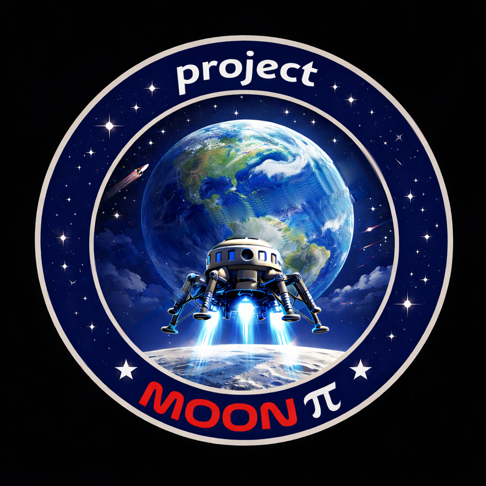

<p align="center"></p>
<p align="center"><b>Designed and Created by Project Moon Pi</b></p>

# Project Moon Pi intro for the Commodore 64

The animated Project Moon Pi logo intro from ProjectMoonPi.com, rebuilt for a real **NTSC Commodore 64**.
It is built to show what the machine can do.

<p align="center"></p>

The intro runs for about 8½ seconds:

1. **Starfield.** Pixel stars stream out from the middle, speeding up.
2. **Coin fly-in.** The badge flies in as a speck, flipping like a coin. It uses up to six multicolour
   sprites, pre-rendered at 13 sizes and 5 flip angles and double-buffered.
3. **Landing.** A white flash and a sideways jolt, then the screen switches video banks to the landed badge.
   The badge is an **FLI picture**, 172 lines tall, with new colours on every line instead of every 8. Six
   sparks fly off the rim.
4. **Light show.** A flare runs round the ring and bursts at the tip. The ring stars twinkle and the engine
   flames flicker.
5. **Credits.** **DESIGNED AND CREATED BY / PROJECT MOON PI** fades in, drawn in the C64's own character set.
6. **Switch-off.** An old-TV switch-off closes the picture to a line, then the machine resets to BASIC.

The SID plays on all three voices as the badge flies in. A filtered sawtooth lead glides from C7 down to C3. A
second voice repeats it 0.15 s later, slightly quieter and 5 cents sharp, as an echo. A pulse-wave bass, two
octaves down with a slowly sweeping pulse width, swells in underneath and ends on a low C1. As the starburst
fires, a bell strikes over a drum, and the bell echoes three times, each repeat softer.

The bell's echoes use a trick, because the SID has no volume setting per voice. Each repeat starts a slow attack,
then closes the gate one frame later. The note only climbs to about 45%, 25% or 15% of full before it rings away.

Any key or the joystick fire button skips the intro.

## Running it

Download from the [latest release](https://github.com/projectmoonpi/c64-moonpi-intro/releases/latest):

| File | What it is | Use it with |
|---|---|---|
| `moonpi-intro.d64` | Disk image with both versions | a real 1541 (written with a ZoomFloppy/XUM1541 and OpenCBM), an SD2IEC, a Pi1541, VICE |
| `moonpi-intro.prg` | The intro on its own (Exomizer version) | a Kung Fu Flash or other SD cartridge, an SD2IEC, VICE |
| `moonpi-intro.crt` | Cartridge image, Magic Desk type (32 KB) | a Kung Fu Flash, VICE, or burned to a Magic Desk-compatible EPROM cartridge |

From disk:

```
LOAD"MOON PI INTRO",8
RUN
```

The disk has two copies of the intro:
- **MOON PI INTRO** is packed with Exomizer (18 KB, 73 blocks). This is the one to load.
- **MOON PI INTRO LZ** uses our own packer and loader (24 KB, 97 blocks).

Both unpack themselves into nearly all 64 KB of RAM, including under the I/O area.

**The cartridge** starts the intro as soon as the C64 is switched on. Its boot code sets up the machine, copies
the Exomizer program from the cartridge's banks into RAM, switches the cartridge off and runs it. The screen
stays black for the 3 seconds it takes to unpack. With the cartridge off, the intro ends in BASIC as usual.
Pressing the reset button turns the cartridge back on, so the intro plays again.

To write the disk to a real 1541 with OpenCBM: `d64copy build/moonpi-intro.d64 8`.

**Needs an NTSC C64 with the 6567R8 VIC chip (65 cycles a line)**, which covers nearly every NTSC C64. The very
first NTSC machines (1982–83, 6567R56A, 64 cycles a line) will show the FLI picture scrambled.

On the Mac:
- `./build.sh` builds the intro: `build/moonpi-intro.d64`, `.prg` and `.crt`.
- `./run.sh` runs it in VICE (NTSC C64, in a window).
- `tools/shots.sh OUT.png CYCLES…` takes screenshots.
- `tools/cal.sh` runs the FLI sprite-timing calibration.

## How it works

| Part | File |
|---|---|
| Converter: badge → FLI picture, coin sprite frames, sprite script, star tables, SID script | `tools/make_assets.py` |
| 6502 program (ACME) | `src/intro.asm` |
| Packer: our own LZ format, with the C64 unpack simulated and checked on every build | `tools/pack.py` |
| Loader: BASIC line, unpacker (runs from the cassette buffer), packed data | `src/loader.asm` |
| Main disk file: Exomizer `sfx` of the same two pieces | `build.sh` |
| Cartridge: boot code, and the CRT file builder | `src/cart.asm`, `tools/make_crt.py` |

**Memory**

| Area | Use |
|---|---|
| $0800–$7FFF | Program |
| $8C00–$9FFF | Tables and music |
| Bank 2 ($8000–$BFFF) | Starfield and coin: screen $8000, sprites $8400, bitmap $A000 |
| Bank 3 ($C000–$FFBF) | The FLI picture: 8 colour screens $C000–$DFFF, bitmap $E000 |

The FLI picture is unpacked into bank 3 at load time, including the RAM under the I/O chips. The landing only
has to switch banks. After the landing, the flare and burst sprites live in the only free 64-byte holes in that
bank.

**FLI with moving sprites.** Each of the badge's 176 raster lines runs 16 bytes of code. The code writes $D018
(which colour screen) and then $D011 on cycle 15. That forces a bad line, so the VIC fetches a fresh line of
colours. On lines where sprites are showing, the VIC takes some extra cycles for the sprite data, which would
make the write late and smear garbage across the left of the badge.

So each line's wait is a `BNE` into a small slide of instructions, and one byte sets how long it waits. Each
frame, the top and bottom lines of the two flare sprites (6 and 7), old and new, give 8 edges. These are sorted,
then swept. Between two edges nothing changes, so a stretch of lines is rewritten only if its delay value
changed, at about 27 cycles a line. This runs at the end of the FLI interrupt, right after the sprite registers
change, so the picture and the patch always match. The worst frame finishes on raster line 35 of the next frame;
the deadline is line 46.

The delays were measured with VICE monitor breakpoints on each line's `STA $D011` (`CAL=1` parks the sprites):

| Sprites on the line | Extra cycles | Patch |
|---|---|---|
| sprite 6 | 5 | removes 4 |
| both | 7 | removes 6 |
| sprite 7 alone | 3 | none: the smallest step, 4, would restart the bitmap row |

Rewriting the patch must never come too early. A write before cycle 15 restarts the bitmap row and scrambles
everything below it.

**Debugging builds.**
- `ACMEDEFS=-DDBG=1 ./build.sh` turns the border red (or yellow) for good if the FLI interrupt ever starts late,
  and records the worst finishing line ($3E) and its frame ($8C).
- `ACMEDEFS=-DDBG=2 ./build.sh` also logs frames 256–447: the finishing line at $0334 and the number of
  patched lines at $0200.
- `ACMEDEFS="-DCAL=1 -DK6=.. -DK7=.. -DK67=.."` is the calibration build.
- Test runs use `+saveres`, so VICE never saves test settings into your own configuration.

**The switch-off** sets bit 6 of $D011 line by line. Extended colour plus bitmap is an invalid VIC mode, which
shows black.

## Credits

- **Project Moon Pi badge and intro design.** Project Moon Pi (`assets/moon-pi-logo.png`, `moon-pi-logo.fx.json`
  from the ProjectMoonPi.com intro).
- **Character set.** Read at run time from the C64's own character ROM (© Commodore). It is not included here.
- **ACME** cross-assembler. Marco Baye and contributors (GPL).
- **VICE** emulator and `c1541`. The VICE team (GPL).
- **Python, Pillow, NumPy.** Their authors (PSF / HPND / BSD licences).
- **Palette values.** The "colodore" C64 palette by Philip "Pepto" Timmermann.
- **VIC-II timing reference.** "The MOS 6567/6569 video controller (VIC-II) and its application in the
  Commodore 64" by Christian Bauer.
- **Exomizer** 3.1.2 by Magnus Lind packs the main disk file. Its decruncher is included in that file
  (Exomizer licence: free to use, as-is). The LZ packer and loader for the second file are our own.
- Built with Claude Code (Anthropic).
